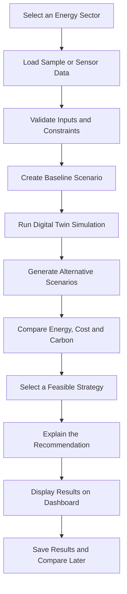

# 🌍 EcoTwin — Turning Energy Data into Intelligent Decisions

### Sense. Simulate. Optimize. Explain.

**An intelligent, multi-sector energy optimization platform powered by Digital Twin concepts, Computer Vision, sensor data, and Generative AI.**

EcoTwin explores a fundamental question:

> What if we could simulate an energy-consuming system before changing how it operates — and choose the option that saves energy, reduces costs, and lowers carbon emissions?

Instead of treating energy monitoring as a collection of charts, EcoTwin aims to turn energy data into actionable decisions. It brings four different environments into one platform, each with its own optimization challenges but a shared sustainability objective.

🔗 **Live Demo:** [Explore EcoTwin](https://eco-twin-optimizer--sharanyapb88.replit.app)

---

## 💡 The Core Idea

Traditional energy dashboards tell us how much energy was consumed.

EcoTwin aims to go further:

- **Sense:** Collect or simulate information about energy consumption and equipment conditions.
- **Simulate:** Create a Digital Twin model of the system and test alternative operating scenarios.
- **Optimize:** Compare feasible strategies based on energy use, electricity cost, and carbon emissions.
- **Explain:** Translate the results into understandable recommendations and actionable next steps.

The platform is designed around one principle:

**Don't just monitor energy waste. Model it, understand it, and find a better way to use energy.**

---

## 🌱 Four Environments. One Intelligence Platform.

### 🧊 01 — Cold-Chain Warehouse Twin

**Challenge:** Refrigerated warehouses consume substantial energy while maintaining strict temperature requirements for perishable goods.

**EcoTwin approach:**
- Monitor temperature variations across warehouse zones.
- Estimate refrigeration energy consumption under different thermal conditions.
- Compare conventional cooling with alternative pre-cooling schedules.
- Evaluate electricity tariffs and operating costs.
- Recommend feasible cooling strategies while respecting validated food-safety limits.

**Hands-on experiment:**

Change the outside temperature and electricity tariff assumptions. Run two cooling scenarios and compare their estimated energy consumption and cost.

**Expected insight:** A schedule that shifts cooling to cheaper hours may reduce electricity costs, but energy savings depend on the thermal model and operating conditions.

### ☀️ 02 — Smart Solar Optimizer

**Challenge:** Solar installations may generate less electricity than expected because of weather, shading, soiling, equipment issues, or other operating conditions.

**EcoTwin approach:**
- Compare expected and actual or simulated solar generation.
- Estimate generation shortfalls and available surplus.
- Analyze demand and renewable-energy utilization.
- Highlight possible performance issues.
- Recommend appropriate inspection and maintenance actions.

**Hands-on experiment:**

Change expected generation, actual generation, and electricity demand. Observe how the generation shortfall and surplus-energy calculations change.

**Expected insight:** Energy performance data can help identify where further investigation or better use of renewable energy may be beneficial.

### 🖥️ 03 — Carbon-Aware Data Center Scheduler

**Challenge:** Computing workloads consume electricity, but the cost and carbon intensity of electricity can vary across time and computing resources.

**EcoTwin approach:**
- Represent computing tasks with energy requirements, durations, and deadlines.
- Evaluate available server capacity and efficiency.
- Compare electricity tariffs and grid-carbon intensity across time slots.
- Schedule eligible flexible workloads.
- Explain the trade-offs between cost, carbon emissions, and completion time.

**Hands-on experiment:**

Create a flexible computing job with a deadline. Change the electricity price and grid-carbon intensity for available time slots, then compare feasible scheduling options.

**Expected insight:** Moving a flexible workload to a lower-carbon time slot can reduce estimated emissions, provided deadlines and operational constraints are satisfied.

### 🏠 04 — Smart Home Energy Reuse Hub

**Challenge:** Solar generation and household demand do not always occur at the same time. Surplus renewable energy may be available while flexible appliances remain unused.

**EcoTwin approach:**
- Monitor or simulate solar generation, household demand, and battery state.
- Identify available surplus energy.
- Prioritize eligible flexible loads such as water heating, washing, and device charging.
- Compare alternative energy-allocation plans.
- Estimate grid imports, electricity costs, and carbon emissions.

**Hands-on experiment:**

Increase midday solar generation, change household demand, and select eligible appliances. Run the optimization and compare the resulting allocation with the baseline.

**Expected insight:** Shifting flexible tasks into periods of available solar generation can reduce later grid imports when the energy allocation and appliance constraints permit it.

---

## 🔄 The EcoTwin MVP Flow

The Minimum Viable Product focuses on demonstrating a complete energy-optimization workflow before adding expensive infrastructure or real hardware.



### MVP execution stages

**Stage 1 — Observe**

Select one of the four modules and inspect the available energy, equipment, and operating-condition data.

**Stage 2 — Establish a baseline**

Calculate the system's estimated energy consumption, cost, and emissions under its current or reference operating conditions.

**Stage 3 — Simulate alternatives**

Change relevant inputs and evaluate alternative schedules, equipment configurations, or energy-allocation strategies.

**Stage 4 — Compare outcomes**

Display baseline and optimized results side by side, including differences in energy consumption, electricity cost, and estimated CO2e emissions.

**Stage 5 — Explain the decision**

Generate an explanation that identifies the proposed action, its expected benefit, the assumptions involved, and any operational constraints.

**Stage 6 — Preserve the experiment**

Where persistence is implemented, save the inputs, results, and recommendation so the user can revisit previous scenarios.

The first MVP can use simulated data and deterministic calculations. Real sensor integration, Computer Vision inference, persistent storage, and live GenAI are extensions to implement and verify separately.

---

## 🧪 Try EcoTwin Hands-On

Use the live website to explore the available interface:

**[Launch the EcoTwin Demo](https://eco-twin-optimizer--sharanyapb88.replit.app)**

For the most useful experiment:

1. Choose a module.
2. Record the baseline energy, cost, and emissions values.
3. Change one or two input parameters.
4. Run the simulation or optimization.
5. Compare the new results against the baseline.
6. Read the recommendation and examine its assumptions.

If a control or simulation is not implemented in the current demo, treat it as a planned capability rather than assuming it is already functional.

---

## 🧮 How EcoTwin Evaluates Improvements

EcoTwin uses transparent calculations to compare alternative scenarios.

| Metric | Calculation principle |
|---|---|
| Energy consumption | Sum of modeled electrical energy usage over the selected period |
| Electricity cost | Energy consumed in each time slot multiplied by its applicable tariff |
| Energy savings | Baseline energy minus optimized energy |
| Cost savings | Baseline cost minus optimized cost |
| Carbon emissions | Electricity consumed multiplied by the applicable grid-carbon intensity |
| Emissions reduction | Baseline emissions minus optimized emissions |
| Renewable utilization | Useful renewable energy consumed divided by available renewable energy, where applicable |

Results depend on the assumptions and quality of the input data. Savings may be zero or negative if the alternative strategy performs worse.

All calculations must maintain consistent units and avoid double-counting energy, especially when battery charging, battery discharge, and renewable generation are involved.

---

## 🧠 Technology and System Architecture

### Frontend
- React
- TypeScript
- Vite
- Tailwind CSS
- Recharts

### Planned backend
- Python
- FastAPI
- Module-specific simulation and optimization engines

### Planned data layer
- SQLite for local prototyping or PostgreSQL for a more persistent application.
- Structured equipment records, sensor readings, simulation runs, and recommendations.

### Planned intelligence components
- **Digital Twins:** Model operating conditions and compare alternative scenarios.
- **Computer Vision:** Analyze relevant equipment or inspection images when suitable image data and a trained or integrated vision model are available.
- **Sensor integration:** Ingest temperature, power, solar generation, battery, and other relevant readings.
- **Generative AI:** Explain validated simulation outcomes and produce contextual recommendations.

The existing frontend is the starting point. These technologies should be considered implemented only when their code, integrations, and functionality have been added and tested.

---

## 🏗️ Development Roadmap

- [x] Create and publish the initial EcoTwin frontend.
- [x] Establish a GitHub repository for the project.
- [ ] Verify all four module interfaces and navigation.
- [ ] Implement deterministic optimization calculations.
- [ ] Develop FastAPI endpoints for the four modules.
- [ ] Connect the frontend to the backend.
- [ ] Add database persistence for readings and simulation history.
- [ ] Develop and validate Digital Twin models.
- [ ] Integrate suitable sensor feeds.
- [ ] Implement a relevant Computer Vision capability.
- [ ] Add live GenAI explanations with appropriate safeguards.
- [ ] Test, document, and deploy the integrated application.

---

## 🌍 Why This Project Matters

Energy sustainability is not one problem with one solution.

A refrigerated warehouse needs thermal stability. A solar-powered campus needs better generation utilization. A data center needs carbon-aware scheduling. A home needs smarter allocation of its available energy.

EcoTwin brings these different challenges into a shared decision-support platform while preserving the specific constraints of each environment.

Its goal is not to claim that every simulation produces guaranteed savings. Its goal is to make energy decisions more transparent, measurable, and easier to evaluate.

---

## 🤝 Contributing

Contributions and ideas are welcome.

Potential areas include:
- Improving energy and carbon calculation accuracy.
- Developing realistic Digital Twin models.
- Building sensor-data ingestion pipelines.
- Implementing Computer Vision for equipment inspection.
- Improving scheduling and energy-allocation algorithms.
- Adding accessible visualizations and tests.

When contributing, document assumptions, use consistent units, test edge cases, and distinguish simulated data from real measurements.

## Running EcoTwin Locally in VS Code

Follow these steps to run the EcoTwin frontend on your local computer.

### Prerequisites

- Node.js 24
- pnpm package manager
- Visual Studio Code
- Git Bash (recommended for this project's shell scripts)

### Step 1: Download the Project

1. Clone the repository or download the ZIP file from GitHub.
2. Extract the ZIP file if downloaded.
3. Open VS Code.
4. Select **File → Open Folder** and choose the `EcoTwin-Optimizer-main` folder.

### Step 2: Open the Terminal

In VS Code, select **Terminal → New Terminal**.

### Step 3: Install Dependencies

In the terminal, navigate to the project root and install the dependencies:

```bash
cd ~/Downloads/EcoTwin-Optimizer-main
pnpm install
```

If you are using PowerShell, navigate to the folder with:

```powershell
cd "$HOME\Downloads\EcoTwin-Optimizer-main"
pnpm.cmd install
```

### Step 4: Start the Frontend

**Using Git Bash:**

```bash
cd ~/Downloads/EcoTwin-Optimizer-main
PORT=5173 BASE_PATH=/ pnpm --filter ./artifacts/ecotwin dev
```

**Using PowerShell:**

```powershell
cd "$HOME\Downloads\EcoTwin-Optimizer-main"
$env:PORT = "5173"
$env:BASE_PATH = "/"
pnpm.cmd --filter ./artifacts/ecotwin dev
```

Wait for the development server to start.

### Step 5: Open EcoTwin in Your Browser

Open the following address in your browser:

http://localhost:5173/

Keep the terminal running while using the website. Press `Ctrl + C` in the terminal to stop the development server.

### Troubleshooting

- **Node.js or pnpm not recognized:** Verify the installations using `node -v` and `pnpm.cmd -v`.
- **PowerShell script execution error:** Use `pnpm.cmd` instead of `pnpm`.
- **Missing Windows native dependencies:** Run `pnpm install` and check the dependency configuration if the error persists.
- **PORT or BASE_PATH missing:** Set both environment variables before starting the frontend.
- **Localhost does not open:** Check the terminal for errors and confirm that Vite is running.

### Important Notes

- `localhost` is accessible only from your own computer.
- To share EcoTwin with others, deploy the frontend to a hosting service or configure local network access.
- The frontend may require a separately configured API server for backend functionality.---

## ⚠️ Disclaimer

EcoTwin is a developing project and decision-support prototype. Simulated readings and modeled savings are illustrative estimates, not verified real-world outcomes.

Real-world deployment requires validation of energy models, equipment constraints, applicable safety requirements, carbon-intensity data, and operational recommendations.

---

### Built to make energy decisions smarter. Designed to make sustainability actionable.

**EcoTwin — Sense. Simulate. Optimize. Explain.**
